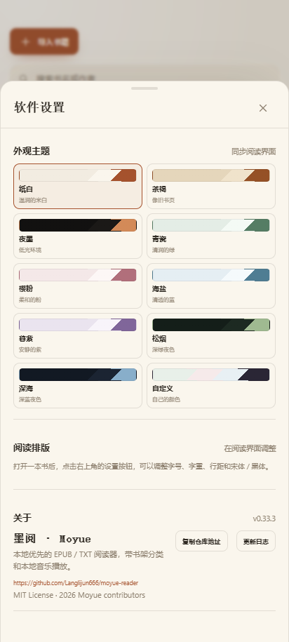

# 墨阅 · Android

墨阅的 Android 版：本地书架、在线书城、EPUB / TXT / PDF / MOBI / AZW3 阅读、目录、书签、划线与笔记、阅读统计。

手机端交互：默认沉浸阅读，轻点正文中间切换工具栏，左右滑动或点击屏幕两侧翻页。暂不包含本地音乐、离线听书和自动更新；设置里可以手动检查更新。

## 网站\n\n手机版官网：https://langlijun666.github.io/moyue-android/\n\n电脑版官网：https://langlijun666.github.io/moyue-reader/\n\n## 下载

- [GitHub Releases](https://github.com/Langlijun666/moyue-android/releases/latest)
- OSS 镜像（ZIP）：`https://moyue-release-files.oss-cn-hangzhou.aliyuncs.com/updates/android/Moyue.Android_0.33.3_arm64.apk.zip`

当前 **v0.33.3 · arm64 · Android 7.0+**，debug 签名测试包，需要允许「安装未知应用」。调试包适合试用，不适合直接上架。\n\n> 阿里云 OSS 默认域名不允许直接公开分发 `.apk`，所以 OSS 渠道提供的是 APK 压缩包；GitHub 渠道可以直接下载 APK。

## 构建

1. 安装 JDK 17、Android SDK（platform 37 / build-tools 37）、NDK 27。
2. 添加 Rust Android target：
   `rustup target add aarch64-linux-android armv7-linux-androideabi i686-linux-android x86_64-linux-android`
3. `npm install`
4. `npx tauri android init --ci`
5. 设置 `JAVA_HOME`、`ANDROID_HOME`、`NDK_HOME`、`GRADLE_USER_HOME`，建议放在非系统盘。
6. `npm run android:build`

Windows 非管理员无法创建符号链接时，构建脚本会自动回退到 Gradle 直接打包；工程路径含中文时，脚本会补上 `android.overridePathCheck=true`。

## 说明

- 桌面版：[moyue-reader](https://github.com/Langlijun666/moyue-reader)
- 本仓库包含完整 Tauri 源码；桌面端的发布流程仍以桌面仓库为准。
- 阅读进度、书签、笔记都保存在本机 WebView 中，清除应用数据会一并清除。
- MIT License。